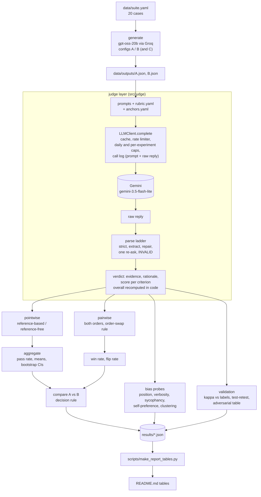

# llm-judge-eval

An LLM-as-judge evaluation pipeline with measured bias mitigations. Given test cases
`{input, system_prompt, model_output, expected_output?, criteria?}` it asks a judge model for a structured verdict
(per-criterion score, a verbatim evidence quote and a rationale), aggregates the verdicts into a suite report,
compares two generator configurations and says whether one of them wins. Each bias handled in code is reported as a
naive-judge number next to a mitigated-judge number.

- **Generator:** `openai/gpt-oss-20b` via Groq (OpenAI family). **Judge:** `gemini-3.5-flash-lite` (Google family), so
  the judge never grades its own family's output. Both are configurable independently through `.env`.
- **Suite:** 20 cases (13 with a reference answer, 7 without). **Main A/B:** the same generator with prompt v1 vs
  prompt v2.
- **Headline:** no significant difference between the two prompts (mean overall difference -0.003, 95% CI
  [-0.36, +0.33], N=20). The naive pairwise judge flipped its winner in 41.7% of pairs when the order was swapped; the
  order-swapped mitigated judge flipped in 0%. The adversarial probes found no wrong answer that either judge
  accepted, so no verbosity or sycophancy improvement is claimed. All small-N results are exploratory and carry their N.
  The tables are [below](#results).

The metric definitions, the pre-registered rules and the call budget (`src/judge/budget.yaml`, printed by
`python -m judge.cli budget`) are stated in this README; the caveats are under [Known limitations](#known-limitations).

## Pipeline



Every judge call, cached or not, appends a row (prompt, raw reply, tokens, latency, cache flag) to `logs/*.jsonl`.
`judge replay` re-runs the parse ladder over those logs with no API call and diffs the result against the saved
verdicts, so the saved scores can be audited without a key.

## Setup

Python 3.11 or newer.

```bash
git clone <this repo> llm-judge-eval
cd llm-judge-eval
python -m venv .venv
source .venv/bin/activate          # Windows PowerShell: .venv\Scripts\Activate.ps1
python -m pip install -e ".[dev]"
```

`make` targets are shortcuts for `python -m judge.cli ...`; on Windows without `make`, run the `python -m judge.cli`
form shown below.

## Reproduce the reported numbers (no API keys needed)

The results, call logs and human labels are committed, so everything reported here can be rebuilt offline. None of
these commands makes a network call.

```bash
python -m pytest -q                                     # unit tests
python -m judge.cli budget                              # planned judge calls per experiment (the dry run)
python -m judge.cli genreport                           # generator check -> results/gen_check.json
python -m judge.cli run --config A B --report-only      # per-config reports from saved verdicts
python -m judge.cli compare --a A --b B                 # A vs B decision -> results/compare_A_vs_B.{json,md}
python -m judge.cli validate                            # kappa, test-retest, adversarial table -> results/validation.{json,md}
python -m judge.cli replay --results results/pointwise_A.json     # re-parse the logged raw replies, expect 20/20 identical
python -m judge.cli replay --results results/pointwise_B.json
python scripts/make_report_tables.py                    # regenerate the tables in this README from results/*.json
```

`python scripts/make_report_tables.py --check` exits 1 if the README tables no longer match `results/`.

## Run the experiments live

Needs a Gemini key (judge) and a Groq key (generator). **These commands overwrite the committed `data/outputs/`,
`results/` and `logs/`.** Run them on a branch or in a copy of the repo, and `git checkout -- data results logs`
restores the reported run. Without a key, `python -m judge.smoke` and the live commands stop with a message naming the
missing variable.

```bash
cp .env.example .env               # then fill GEMINI_API_KEY and GROQ_API_KEY
python -m judge.smoke              # one judge call and one generator call; fails if a model id is not served
python -m judge.cli budget         # always check the plan before spending calls
python -m judge.cli generate       # generator outputs for configs A and B   (Groq, no judge calls)
python -m judge.cli run --config A B                  # mitigated pointwise judging + reports   (~40 judge calls)
python -m judge.cli position                          # pairwise, both orders, flip rate, controls
python -m judge.cli compare --a A --b B               # offline
python -m judge.cli probes                            # verbosity + sycophancy probes
python -m judge.cli sensitivity
python -m judge.cli hard
python -m judge.cli selfpref
python -m judge.cli clustering
python -m judge.cli retest
python -m judge.cli validate                          # offline
python scripts/make_report_tables.py
```

The whole plan is 262 judge calls (cap 303; `judge budget` prints the split), 58% of the client's daily guard of 450
on the Gemini free tier (15 requests per minute, 500 per day; the client limits itself to 12 per minute), about 22
minutes of wall time. Each experiment has its own cap in
`src/judge/budget.yaml`; a run that would pass its cap is refused, and batch runs checkpoint so they resume without
repeating work. Responses are cached under `.cache/`, which a fresh clone does not have, so a live re-run of an
experiment spends real calls and, because the model is not perfectly deterministic, can give slightly different
verdicts than the committed ones. The committed `logs/` and `results/` are the record of the reported run.

Settings are environment-only (`.env`; names in `.env.example`). The family guard refuses a judge from the same family
as the generator unless `ALLOW_SAME_FAMILY=1`.

## When each judging mode fits

| mode | use it when | cost | what it gives | evidence from this project (N is small, exploratory) |
|---|---|---|---|---|
| **Pointwise, reference-based** (mitigated) | A trusted reference answer exists: extraction, arithmetic, policy or passage QA. | 1 call per answer | Per-criterion scores with a verbatim evidence quote, a pass/fail from the pre-registered rule, a mean with a CI over a suite. | Rejected all 6 confidently-wrong answers and all 6 right-answer-plus-invented-reasoning answers; accepted all 6 terse-correct answers. Kappa 0.72 vs by-construction labels (interval [0.00, 1.00]). It can miss what the reference does not pin down: it passed c01's answer that drops the reference's "unless reserved" qualifier, which the human label fails. |
| **Pointwise, reference-free** (mitigated) | No gold answer, but the answer must be grounded in a passage in `input` and obey the system prompt (summaries, support replies, extraction from a given text). | 1 call per answer | The same scores, judged only against `input` and `system_prompt`. | Still rejected 6/6 wrong answers because the facts were in the passage. The 7 reference-free suite cases averaged 4.95, which is a ceiling and separates nothing. It cannot check a fact that is not in `input`: the rubric forbids filling gaps from world knowledge. |
| **Pairwise, both orders** (mitigated) | You need a head-to-head ranking of two systems or prompts, or want a cross-check on a pointwise A/B. | 2 calls per pair | A winner per pair, or TIE when the two orders disagree; win rate with a CI and a flip rate. | Picked the correct answer in 6/6 correct-vs-wrong pairs in both orders, so it does decide when there is a real gap. On the real A/B it returned TIE for 16 of 20 pairs, so it has low resolution when answers are close. |
| **Naive** (holistic 1-10, single prompt, no anchors, no evidence) | Only as the baseline for a before/after bias comparison. Do not use it for a decision. | 1 call (pointwise) or 1-2 (pairwise) | One number. | Flipped its pairwise winner in 5 of 12 pairs when the order swapped; its single score cannot separate "too long" from "wrong". |
| **A deterministic check, no judge** | The requirement is countable or exact: word and sentence limits, bullet counts, required strings, exact match. | 0 calls | Exact, repeatable labels. | The judge miscounted words once (c39) and its instruction-following score is the noisiest in the retest (7/10 cases identical). Use `src/judge/checks.py` for these constraints and keep the judge for meaning. |

Two practical rules follow. Report the pointwise suite numbers with their CIs and use pairwise as a corroborating
check, not the only evidence. And when most answers are good, expect the scores to pile up near the top whichever mode
you use (14 of 20 cases are 5/5/5 under both configs here), so the useful signal is in the few cases that differ.

## Rubric and verdict

Three criteria, scored 1-5 and weighted in `src/judge/rubric.yaml`: faithfulness 0.40, instruction-following 0.35,
completeness 0.25. The judge returns the three scores only; the overall is recomputed in code as the weighted mean, and
any `overall` in the reply is ignored. Pass rule, fixed before the A/B run: faithfulness >= 4 and
instruction-following >= 3 and overall >= 3.5. In the mitigated prompts every criterion needs one verbatim quote from
the answer before its score, a 4 or 5 without a verifiable quote is flagged, and the rubric states that length and a
confident tone earn no credit. Malformed replies go down the parse ladder (strict, extract, repair, one re-ask, INVALID);
an INVALID verdict is counted, never dropped.

## Metric definitions

Defined before any experiment; `N` is always stated next to a result, and every small-N probe is exploratory.

| Quantity | Definition |
|---|---|
| Overall score | weighted mean of the three criterion scores (1-5), recomputed in code; the judge's own arithmetic is never trusted |
| Pass rule | faithfulness >= 4 and instruction-following >= 3 and overall >= 3.5; fixed before the A/B run (`src/judge/rubric.yaml`) |
| Pair verdict | both orders are judged; if the winners agree that is the verdict, otherwise TIE and the pair is flagged as an order flip |
| Win rate (A over B) | (wins of A + 0.5 x ties) / N pairs, after the order-swap rule |
| Flip rate | share of pairs whose winner changes when the order is swapped, counted before the tie rule; reported for the naive and the mitigated judge |
| Position preference | on identical-answer control pairs (A = B), 6 pairs judged in one order each per judge: share that picks the first-listed answer; unbiased is about 50% or a tie (exploratory, N=6) |
| Length bias | Spearman(length, overall) within a quality group, plus the pointwise score delta between a padded answer and its original (exploratory, N=6 base cases) |
| Self-preference | 6 pairs where both answers are correct by a deterministic check, one authored by gpt-oss-20b and one by Gemini; judged in both orders. Own-family win rate = (pairs won by the Gemini answer + 0.5 x ties) / N pairs, 50% = no preference; 95% exact binomial CI on the decisive pairs only. N=6 can show a large effect at most, never absence of one |
| Fooled rate | share of adversarial probes where a confidently-wrong answer gets faithfulness >= 4, or a verbose-wrong answer scores at or above the terse-correct answer on the same base case (exploratory, N=6) |
| Score spread | standard deviation, number of distinct values used, share at the modal value; clustering means narrow spread |
| Agreement, kappa | agreement rate and Cohen's kappa on pass/fail against human labels and against by-construction labels; kappa is implemented in this repo and checked by a hand-computed unit test |
| Test-retest | the suite is re-run with the cache bypassed (nonce): share of cases whose pass/fail flips, and score standard deviation |

**Main A/B decision rule (pre-registered before any judge call).** Three generator configs were produced without
judge calls: A = gpt-oss-20b with prompt v1, B = gpt-oss-20b with prompt v2, C = qwen3.8-27b with prompt v1. Two cheap
checks are compared (`judge genreport`): the deterministic constraint pass rate over the 20 cases, and the strict
exact-match rate over the 13 reference-based cases. If C differs from A by 10 percentage points or more on either check,
the main A/B is model A against model C with the same prompt; otherwise it is prompt v1 against prompt v2 on
gpt-oss-20b (A against B) and C is dropped. The outcome is in the results below.

**Declaring a winner.** Comparisons are paired per case. A config wins only if the bootstrap 95% CI of the mean overall
difference excludes 0 and the order-swapped pairwise win rate leans the same way; otherwise the report says "no
significant difference" and states N.

**Human labels.** How they were produced, and why two of them are not blind, is under
[Known limitations](#known-limitations).

## Bias handling at a glance

| bias | mitigation in code | how it is measured | result |
|---|---|---|---|
| position | both orders judged; disagreement gives TIE and is flagged | flip rate, first-position share, identical-answer controls | naive 41.7% flips; mitigated 0% on the same 12 pairs |
| verbosity | length-earns-no-credit rule, evidence quote required, instruction-following scored apart | padded vs terse-correct score delta, Spearman(words, score) | no verbosity bias seen in the mitigated judge (+0.06); the naive -6.0 is a length-limit penalty, not an anti-length judge |
| self-enhancement | family guard (judge and generator must differ in family); residual probed | own-family win rate on 6 correct-vs-correct pairs | 0.75, CI on the 3 decisive pairs [0.29, 1.00]; inconclusive, and each decisive win had a content reason |
| sycophancy | per-criterion verbatim evidence; reference-free and fabricated-reasoning probes | share of wrong answers accepted | 0/6 for both judges, a floor effect: no before/after claim |
| score clustering | six few-shot anchors, per-criterion scores | spread of scores on the same 12 cases, good-vs-corrupted separation | no improvement shown; both judges pile up at the top |

## Results

The tables in this section are generated from `results/*.json` by `scripts/make_report_tables.py`.

<!-- BEGIN GENERATED TABLES (scripts/make_report_tables.py) -->

_Generated by `python scripts/make_report_tables.py` from `results/*.json`; do not edit by hand._

#### Setup

| item | value |
|---|---|
| judge | `gemini-3.5-flash-lite` (Google), JSON mode off (prompt-only JSON) |
| generator | `openai/gpt-oss-20b` via Groq (OpenAI family) |
| suite | 20 cases: 13 reference-based, 7 reference-free |
| pass rule | faithfulness >= 4, instruction-following >= 3, overall >= 3.5 |
| parse status, config A | strict: 20 |

#### Generator check and the pre-registered A/B rule

| generator config | constraint pass | exact match (reference-based) | mean output tokens |
|---|---|---|---|
| A: gpt-oss-20b, prompt v1 | 20/20 | 3/13 | 61 |
| B: gpt-oss-20b, prompt v2 | 19/20 | 3/13 | 69 |
| C: qwen3.8-27b, prompt v1 | 19/20 | 3/13 | 214 |

C minus A: -5.0 pts constraint, +0.0 pts exact match. Pre-registered rule (10-point threshold on either check) selects **prompt v1 vs v2 (A vs B)**.

#### Main A/B: prompt v1 vs prompt v2 (pointwise, mitigated judge)

|  | A (prompt v1) | B (prompt v2) | A - B, paired |
|---|---|---|---|
| mean overall (1-5) | 4.610 [4.133, 4.947] | 4.612 [4.175, 4.938] | -0.003 [-0.362, +0.325] |
| faithfulness | 4.600 [4.000, 5.000] | 4.500 [3.900, 5.000] | +0.10 [-0.50, +0.70] |
| instruction-following | 4.700 [4.300, 5.000] | 4.750 [4.350, 5.000] | -0.05 [-0.35, +0.25] |
| completeness | 4.500 [3.900, 4.950] | 4.600 [4.100, 4.950] | -0.10 [-0.60, +0.30] |
| pass rate | 18/20 = 0.90 | 17/20 = 0.85 | +0.05 [-0.10, +0.20] |

Pairwise, mitigated, both orders: win rate A over B **0.550** [0.450, 0.650] (N=20: A 3 / B 1 / tie 16; flip rate 0.0%); on the 14 pairs whose answers differ: 0.571 [0.429, 0.714].

**Decision: no significant difference** (CI of the mean overall difference [-0.362, +0.325] spans 0). 14 of 20 cases have an identical overall under A and B.

#### Bias: naive vs mitigated judge

| position bias | naive | mitigated |
|---|---|---|
| flip rate, same 12 pairs, both orders | 5/12 = 41.7% | 0/12 = 0.0% |
| hard flips (opposite decisive winners) | 2/12 | 0/12 |
| share choosing the first-listed answer (decisive) | 66.7% | 50.0% |
| verdicts A / B / tie | 7 / 4 / 1 | 3 / 1 / 8 |
| identical-answer controls, one order | first 0 / second 0 / tie 6 (N=6) | first 0 / second 0 / tie 6 (N=6) |
| flip rate, all 20 A/B pairs | not run (naive was 12 pairs) | 0/20 = 0.0% |
| sensitivity: picked the correct answer of correct-vs-wrong, both orders (N=6) | 6/6 | 6/6 |

| verbosity and sycophancy probes (N=6 bases) | naive | mitigated |
|---|---|---|
| padded minus terse-correct, mean score delta | -6.00 (1-10) | +0.06 (faith+compl, 1-5) |
| padded minus terse-correct, instruction-following | n/a | -3.00 |
| Spearman(words, score), correct group, n=12 | -0.74 | +0.44 |
| confidently wrong accepted, reference shown | 0/6 | 0/6 |
| confidently wrong accepted, reference hidden | 0/6 | 0/6 |
| verbose-wrong scored >= terse-correct | 0/6 | 0/6 |
| right answer + fabricated reasoning accepted | 0/6 | 0/6 |

| score clustering and self-preference (exploratory) | naive | mitigated |
|---|---|---|
| distinct score values, same 12 cases | 3 | 5 (overall); 2 (faithfulness) |
| share at the modal value | 66.7% | 66.7% (overall); 83.3% (faithfulness) |
| sd / scale width | 0.367 | 0.291 (overall); 0.373 (faithfulness) |
| own-family win rate, Gemini-authored vs gpt-oss, N=6 pairs | not run | 0.75: Gemini 3 / gpt-oss 0 / tie 3; 95% CI on decisive share [0.29, 1.00] |

Read these tables with the stated N. The mitigations' measured effect is clear for position bias on the naive single-order baseline (flip rate 41.7% to 0%). For verbosity, sycophancy and clustering the naive judge already sat at the floor or ceiling, so no before-to-after improvement is claimed (see Known limitations).

#### Judge validation

| judge vs labels | N | agreement (always-pass baseline) | Cohen kappa [95% bootstrap] | false pass | false fail |
|---|---|---|---|---|---|
| mitigated vs by-construction labels, suite distinct (headline) | 34 | 0.94 (0.88) | 0.72 [0.00, 1.00] | 1/4 | 1/30 |
| naive vs by-construction labels, suite distinct | 13 | 1.00 (0.85) | 1.00 [1.00, 1.00] | 0/2 | 0/11 |
| mitigated vs human labels (c09, c16 not blind) | 20 | 0.95 (0.85) | 0.77 [0.00, 1.00] | 1/3 | 0/17 |
| naive vs human labels | 13 | 0.92 (0.77) | 0.75 [0.00, 1.00] | 1/3 | 0/10 |
| mitigated vs by-construction, probes (designed extremes) | 36 | 1.00 (0.17) | 1.00 [1.00, 1.00] | 0/30 | 0/6 |
| naive vs by-construction, probes | 36 | 0.94 (0.17) | 0.77 [0.30, 1.00] | 0/30 | 2/6 |
| mitigated, instruction-following vs `checks.py` (40 outputs) | 40 | 0.93 (0.97) | -0.03 [-0.08, 0.00] | 1/1 | 2/39 |

| test-retest (temperature 0, nonce bypasses the cache) | value |
|---|---|
| design | 10 cases x 3 runs (saved run + 2 nonce reruns) |
| pass/fail flips | 0/10 (95% exact CI [0.00, 0.31]) |
| overall sd per case, mean / max | 0.095 / 0.404; 4 of 10 cases changed at least once |
| criterion scores identical across all runs | faithfulness 10/10, instruction-following 7/10, completeness 9/10 |

| negative control | naive | mitigated |
|---|---|---|
| terse-correct answers accepted (N=6) | 4/6 | 6/6 |
| discrimination = correct accepted rate - fooled rate | 0.67 | 1.00 |

#### Judge cost

| judge usage | calls | network calls | re-asks | tokens in / out | list-price equivalent |
|---|---|---|---|---|---|
| pointwise A | 20 | 15 | 0 | 71,267 / 5,421 | $0.0262 |
| pointwise B | 20 | 14 | 0 | 71,185 / 5,448 | $0.0248 |
| pairwise (both orders) | 40 | 32 | 0 | 57,948 / 15,316 | $0.0454 |
| A/B comparison total | 80 | 61 | 0 | 200,400 / 26,185 | $0.0964 |

Actual cost $0.00 (free tier). List price $0.3/1M in, $2.5/1M out (`standard` tier, retrieved 2026-10-23, https://ai.google.dev/gemini-api/docs/pricing).

<!-- END GENERATED TABLES -->

## Repository layout

| path | contents |
|---|---|
| `src/judge/` | the package: `llm.py` (the only HTTP layer), `prompts.py` + `prompts/`, `rubric.yaml`, `anchors.yaml`, `parse.py`, `pointwise.py`, `pairwise.py`, `aggregate.py`, `compare.py`, `probes.py`, `selfpref.py`, `clustering.py`, `validate.py`, `budget.yaml`, `cli.py` |
| `data/suite.yaml`, `data/configs/` | the 20-case suite and the generator configs A, B, C |
| `data/outputs/` | generated model outputs per config |
| `results/` | every reported number as JSON (and `.md` summaries) |
| `logs/` | JSONL call logs: every judge prompt and raw reply |
| `labels/human_labels.jsonl` | the author's pass/fail labels for the 20 config-A answers |
| `scripts/make_report_tables.py` | builds the README tables from `results/` |
| `tests/` | unit tests, including hand-computed metric checks |

## Known limitations

- **Few-shot anchors can pull scores toward their own levels.** The mitigated pointwise prompts include six
  hand-written calibration anchors (`src/judge/anchors.yaml`; overall scores 1.35, 3.15, 3.70, 4.00, 4.30 and
  5.00) to fight score clustering. With so few examples, the judge may copy their score profile or their
  wording instead of grading the case, so the anchors themselves are a bias source. They are written by hand,
  kept out of the eval suite, listed in mixed order, and the reference-free prompt only sees the five
  reference-free ones. Their effect is measured in the clustering experiment (naive vs mitigated spread), not
  assumed.
- **The lower parse-ladder rungs are proven by tests, not by live use.** The ladder is strict -> extract -> repair ->
  one re-ask -> INVALID (`src/judge/parse.py`). In the 5-case live check Gemini returned bare JSON every time,
  so only `strict` was exercised against the real judge; `extract`, `repair` and `reask` are covered by a 46-reply
  malformed corpus and mock-transport tests (some samples, such as gpt-oss-style reasoning before the JSON, are
  synthetic). The real INVALID and re-ask counts come from the full run and are reported in the results, not assumed.
- **A near-ceiling judge is a flag, not a finding.** The first 5 live verdicts were all PASS with 17 of 20 criterion
  scores at 5. That cannot separate leniency from good outputs. The adversarial probes (confidently-wrong, padded,
  verbose-wrong) and the negative controls are the real test; if they also score near 5, the judge is investigated
  before any number is reported.
- **The generator decision rule is a coarse screen.** Whether the main A/B contrasts models (gpt-oss-20b vs qwen) or
  prompts (v1 vs v2) is decided by a 10-percentage-point threshold on two cheap checks (constraint pass rate over 20
  cases, strict exact-match over 13). One case is worth 5 and 7.7 points, so two cases flip it; it is not a
  significance test. It was fixed before any judge call.
- **The suite contains deliberate temptation cases (c41-c44) that favour prompt v2 by construction.** Their system
  prompts do not tell the model to abstain, and v2's preamble does. That is a designed probe of grounding, chosen
  before judging because A and B were both at the ceiling on hard constraints; it is not a neutral sample of tasks.
- **Human labels: revised by the author, two not blind.** `labels/human_labels.jsonl` (20 config-A answers) was
  filled in outside the project tooling (the tooling only generated the blank template) and revised by the author after
  a second review; that is the author's report, not something the repository can verify. The first version equalled an
  LLM-rater draft (removed from the tree, commit 567bfd8) on all 20 items; the revised version differs on c01 only
  (pass -> fail, dropped 'unless reserved' qualifier). For c09 and c16 the labels are not blind: the original answers'
  errors were already known from earlier reports. N=20 with 3 label-fail, so judge-vs-human agreement is exploratory.
  The headline agreement is against the deterministic by-construction labels (suite, N=34).
- **The instruction-following check has almost no negatives.** Only 1 of the 40 suite outputs (c23 under config B)
  violates a countable constraint in `checks.py`, so judge-vs-checks agreement (0.93) is below the always-pass
  baseline (0.97) and its kappa is not interpretable. The adversarial probes are a floor effect: both judges are
  fooled 0/6, so no mitigation effect can be shown.
- **Test-retest zero flips is partly luck.** 0/10 pass/fail flips at judge temperature 0.0, with noise in
  instruction-following; two cases (c33, c39) sit on the instruction-following = 3 pass boundary, so one more point
  of noise would flip them. N=10 shows none were seen, not that flips are rare.

